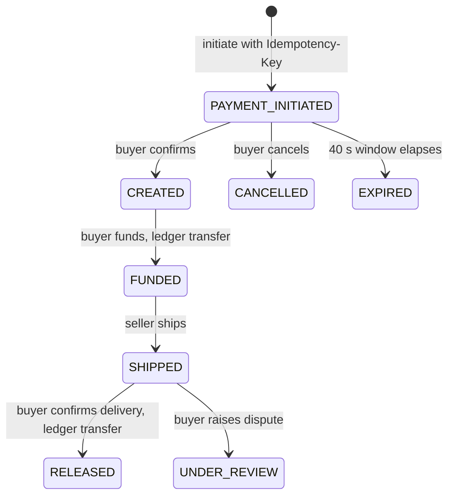
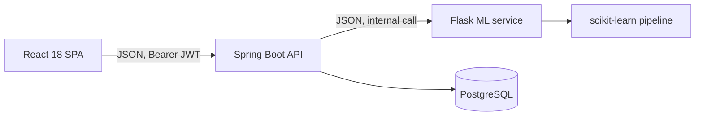

# SIVA CHARAN KOLLAPURAM GANDLA

**Software Engineer · Backend Systems · Full-Stack Development · Applied Machine Learning**

*I build software systems with a focus on backend correctness, interactive tools, and practical applications.*

[Portfolio](https://protofolio-site.vercel.app) · [LinkedIn](https://linkedin.com/in/siva-charan-kg-72a900284) · [LeetCode](https://leetcode.com/u/siva_2853/) · [Email](mailto:kgsivacharan2005@gmail.com)

---

## About

I am a final-year B.Tech student in Computer Science and Engineering at G. Pullaiah College of Engineering, Kurnool (CGPA 8.51, expected May 2027). I am looking for software engineering roles, with my deepest work in backend services, full-stack applications, and practical machine learning.

I enjoy problems where correctness is non-negotiable: financial state that must always balance, algorithms whose behaviour should be inspectable step by step, and models whose predictions have to be served and explained reliably. I have solved 500+ problems on LeetCode to keep my data-structure and algorithm fundamentals strong. I hold the SAP Certified Back-End Developer (ABAP Cloud) certification.

---

## What I build

- **Backend correctness and secure application design:** explicit state machines, ownership checks on sensitive actions, and transactional writes (RevertPay).
- **Full-stack systems:** React front ends backed by Spring Boot REST APIs and PostgreSQL (RevertPay, EDU2JOB).
- **Interactive developer tools:** a browser-based algorithm laboratory with recorded execution, replay controls, and automated tests (AlgoViz 2.0).
- **ML-powered applications:** a scikit-learn model served from a Flask API and integrated into a Spring Boot application (EDU2JOB).

---

## Featured projects

Live demo: [AlgoViz 2.0](https://algoviz-2-0.vercel.app). RevertPay and EDU2JOB run from their repositories.

### 1. RevertPay: escrow and payment-reversal platform

**[Repository](https://github.com/Siva2583/RevertPay-v-1.0)** · v1.0 working core

An escrow and payment-reversal platform built around financial invariants: a double-entry ledger with no stored balance column, a validated escrow state machine, and money movement that commits or rolls back with the escrow state it belongs to.

**Stack:** Java 25 · Spring Boot 4.1.1 · Spring Security · JWT (HS256) · BCrypt · Spring Data JPA / Hibernate · PostgreSQL · React 19 · Vite 8

**Highlights**

- **Double-entry ledger, derived balances.** Each transfer writes one debit and one credit in a single transaction. Balances are computed as credits minus debits, so a stored balance cannot drift from its history.
- **Validated escrow lifecycle.** Nine states and one transition table. Illegal transitions are rejected, and every legal change is appended to an audit log with the actor, reason, and timestamp. Unconfirmed payments expire after 40 seconds through a 5-second scheduled sweep.
- **Atomic money and state changes.** Funding and delivery confirmation run the ledger write and the status change in one `@Transactional` method. If the transition is rejected, the ledger entries roll back with it.
- **Duplicate protection and concurrency control.** Escrow creation requires an `Idempotency-Key` header stored under a unique constraint, so a duplicate is rejected at the database level. `@Version` on escrow rows makes conflicting concurrent updates fail instead of overwriting each other.
- **Authorization on escrow actions.** Only the buyer can fund, confirm, cancel, dispute, or confirm delivery; only the seller can ship. Each request's JWT is verified and the user is reloaded from the database, so roles are read from current data.

**Known limits and planned work**

These are not implemented yet, or are only partly implemented:

- Ownership checks cover escrow actions. The account lookup, ledger statement, and direct transfer endpoints do not yet verify that the caller owns the account. This is the next fix.
- JWT revocation (a denylist) is not implemented, so a token stays valid until it expires after one hour.
- Retried requests are rejected, not replayed. The original response is not returned, and there is no balance check before funding.
- Automatic release at `autoReleaseAt` is recorded but not enforced. Dispute resolution and refunds exist in the state machine but have no endpoints yet.
- The backend test files are present but commented out, so the repository has no active automated tests yet. The priority tests are transition validity, duplicate initiation, unauthorized access, and concurrent release.

RevertPay is a portfolio project. It uses demo balances and is not a payment gateway integration or a production financial service.

---

### 2. AlgoViz 2.0: interactive algorithm laboratory

**[Repository](https://github.com/Siva2583/Algoviz-2.0)** · **[Live demo](https://algoviz-2-0.vercel.app)** · 

A browser-based learning tool that records each sorting run as a sequence of frames, then lets you replay, pause, step, seek, and compare those recorded executions.

**Stack:** React 19 · JavaScript · Vite · React Router 7 · Tailwind CSS · Node.js test runner · ESLint · GitHub Actions · Vercel

**Highlights**

- **Engine separated from the UI.** `src/lab/engine.js` has no React imports. It validates inputs and generates recorded frames for six sorting algorithms, and React only renders the selected frame.
- **Playback as an explicit reducer.** Play, pause, step, seek, and replay are reducer actions with bounded cursor values. A timer effect drives advancement and is cleaned up when its inputs change. A speed control adjusts the interval.
- **Reproducible experiments.** Datasets are generated from seeds, and element IDs stay stable across frames. Up to six experiments can be saved in browser `localStorage` and exported or imported as JSON (16 KB limit).
- **Comparison and counterexample tools.** Comparison mode runs two algorithms on identical input and compares recorded comparison events. A counterexample lab shows how a sliding-window condition (`>=` versus `===`) changes the answer, and searches a bounded input domain for a failing case.
- **Automated checks in CI.** The suite has 14 test groups. It covers sorting correctness and trace reproducibility across 150 input cases (6 algorithms × 25 inputs), and checks the sliding-window reference against a brute-force oracle across 768 array-and-target combinations (64 arrays × 12 targets). CI runs tests, lint, and build on every push and pull request.

These checks are bounded: sorting input is capped at 24 elements and the counterexample search covers a small domain. They support the specific behaviours tested, not a proof for all inputs.

---

### 3. EDU2JOB: career recommendation with applied ML

**[Repository](https://github.com/Siva2583/EDU2JOB-SPRING)**

A full-stack career-recommendation application. Students enter their degree, major, CGPA, and skills; the Spring Boot API forwards the request to a Flask service that runs a scikit-learn model and returns the top job roles.

**Stack:** React 18 · Chart.js · Spring Boot 3.2.4 · Java 21 · JWT (jjwt) · BCrypt · Flask · scikit-learn 1.6.1 · Pandas · NumPy · PostgreSQL

**Highlights**

- **Trained model served as an artifact.** A scikit-learn pipeline one-hot encodes degree and major, scales CGPA, and applies a 30-token multi-label encoding to skills. The features feed a Random Forest, and isotonic calibration is applied over five folds (1,000 trees in total).
- **Ranked output.** The service returns the top five roles by probability, with a 4% floor and a short career-scope description for each role.
- **Clear service boundaries.** Spring Boot handles authentication, profiles, and prediction history. The Flask service handles feature encoding and inference and keeps no request state. The browser only talks to Spring Boot.
- **Auditable prediction history.** Each prediction is stored with its inputs and the raw model response. The analytics view summarises past results with Chart.js.
- **Practical feature-preparation issue.** Skills outside the model's 30-token vocabulary are dropped by the encoder. I have documented this as a known issue, with surfacing it to users on the roadmap.

**Limits**

- The repository includes the trained model but not the training code, dataset, or evaluation results. This README therefore makes no accuracy claims.
- Recommendations reflect patterns in historical data. They are not validated career advice.
- The JWT signing secret and the Flask service URL are hard-coded in the source. Moving them to configuration is on the roadmap.

---

## Technical skills

**Languages:** Java · Python · JavaScript · SQL

**Frontend:** React · HTML · CSS · Tailwind CSS · Vite · Chart.js

**Backend:** Spring Boot · Spring Data JPA · Hibernate · Spring Security · REST APIs · Node.js · Express.js · Flask · JWT · BCrypt

**Databases:** PostgreSQL · SQL

**Machine learning:** scikit-learn · Random Forest · Pandas · NumPy · Data preprocessing · Categorical encoding · Probability calibration

**Tools and practices:** Git · GitHub · GitHub Actions · Maven · Vite · Node.js test runner · Vercel

**Core computer science:** Data structures and algorithms · Object-oriented programming · 500+ LeetCode problems solved

---

## Engineering principles

- **Explicit state transitions.** Escrow changes pass through one transition table. Illegal moves are rejected, and every legal move is logged (RevertPay).
- **Secure resource ownership.** Escrow actions check that the caller is the buyer or seller before any business logic runs. Account-level endpoints are the known gap (RevertPay).
- **Transactional consistency.** Ledger writes and state changes share a transaction, so a failed step does not leave partial money movement (RevertPay).
- **Reproducible execution.** Runs produce deterministic frames and seeded datasets, so an experiment can be replayed and shared (AlgoViz 2.0).
- **Automated validation.** AlgoViz 2.0 runs tests, lint, and build in CI. RevertPay and EDU2JOB still need active test suites.
- **Separation of concerns.** The algorithm engine is independent of the UI (AlgoViz 2.0). Business logic is in Java and inference is in Python (EDU2JOB).
- **Honest evaluation.** I only claim what the repository demonstrates. For EDU2JOB, I make no accuracy claims because the evaluation harness is not in the repository.

---

## Certifications and achievements

- **SAP Certified – Back-End Developer – ABAP Cloud**
- **NPTEL, Programming, Data Structures & Algorithms using Python**
- **500+ problems solved on [LeetCode](https://leetcode.com/u/siva_2853/)**

---

## Contact

- **GitHub:** [github.com/Siva2583](https://github.com/Siva2583)
- **LinkedIn:** [linkedin.com/in/siva-charan-kg-72a900284](https://linkedin.com/in/siva-charan-kg-72a900284)
- **Portfolio:** [protofolio-site.vercel.app](https://protofolio-site.vercel.app)
- **LeetCode:** [leetcode.com/u/siva_2853](https://leetcode.com/u/siva_2853/)
- **Email:** [kgsivacharan2005@gmail.com](mailto:kgsivacharan2005@gmail.com)

---

I learn by building complete systems, checking them against their own invariants, and documenting where they fall short. The repositories above show the unfinished parts as well as the working ones.
